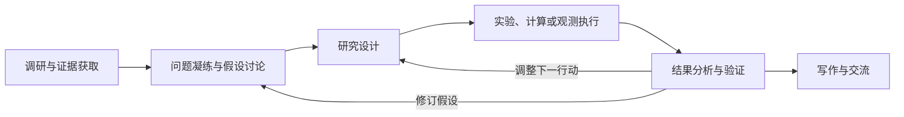

# 跨学科共同科研流程与智能体参与方式

日期：2026-11-01。

本材料是阅读提要与跨领域证据索引。正式论证已并入中英文综述第 8.1 节“共同科研流程与任务委托模式”，参与程度的解释并入第 8.3 节，结论 RQ2、RQ4 同步更新。本文件不另存整段正文。

## 核心概括

已核查代表案例反复呈现的安排是：人类提供科研目标、先验知识、研究平台或评价条件，智能体承担信息处理、候选生成、工具执行及部分后续行动选择。科研参与的增加既可能表现为覆盖更多阶段，也可能表现为在某一阶段获得更多决策权限。两者需要分别记录。

这是一项跨案例定性综合，不是对全部 663 篇工作的阶段频率或自主性占比统计，也不意味着每个学科、每项系统都完成全部流程。

## 共同流程

调研与证据获取 → 问题凝练与假设讨论 → 研究设计 → 实验、计算或观测执行 → 结果分析与验证 → 写作与交流。

这些阶段是共同科研活动的概括。系统可以从给定问题、数据集或观测事件进入，也可以仅承担“设计—执行—分析—修订”的内部循环。验证贯穿各阶段，图中单列分析与验证是为了强调其独立作用，不能解释为此前无需检查。

| 阶段 | 人们交给智能体的具体工作 | 需要单独记录的科学判断或条件 |
|---|---|---|
| 调研与证据获取 | 检索文献、查询数据库、提取信息、整理已有证据 | 来源是否可靠，研究范围与相关性如何界定 |
| 问题凝练与假设讨论 | 生成候选、比较解释、细化问题、提出可检验建议 | 谁选择研究问题，如何判断重要性、新颖性与可检验性 |
| 研究设计 | 选择样品或观测、配置参数、选择工具、分配资源、安排步骤 | 谁规定搜索空间、允许干预、预算和评价标准 |
| 执行 | 运行代码或求解器、调用仪器、执行机器人操作、获取观测 | 谁准备平台、授权操作，以及处理超出系统能力的故障 |
| 分析与验证 | 处理数据、计算指标、比较结果、检测错误、提出下一步 | 科学量及假设是否正确，有无适当对照和独立验证 |
| 写作与交流 | 图表生成、结果汇总、报告或论文草拟、评议 | 陈述是否可追溯，局限如何解释，由谁审定科学结论 |

“探讨”对应问题细化、假设比较及可检验性评估；多智能体对话是实现方式之一。对话数量或角色数量不能直接作为科学判断能力的证据。

## 十一领域的共同活动与具体差异

以下使用已纳入领域正文的案例说明委托关系，不将一个案例概括为整个学科的统一状态。稳定 ID 用于定位现有论文记录；正文事实及引用以第 6 节对应小节为准。

| 模块 | 所选案例及已有来源 | 主要委托活动 | 保留的目标、条件或验证边界 |
|---|---|---|---|
| 01 形式、信息与计算 | FunSearch：ASD-0512；Agent Laboratory：ASD-0018 | 程序生成与评价；围绕给定构想开展调研、实验和报告 | 评价器、程序骨架或研究构想由人类提供；输出正确性与科学新颖性分别判断 |
| 02 物理、天文与宇宙 | k-agents：ASD-0090；宇宙学分析：ASD-0121 | 实验流程执行、校准重试、编码与参数分析 | 装置与实验知识约束允许行动；部分代码执行前需管理员或人类核验 |
| 03 化学 | 合成协议数字化：ASD-0600；反应探索：ASD-0734 | 协议转换、反应选择与执行、分析反馈 | 专家修正、化学家后续研究和产物表征仍具有实质作用 |
| 04 材料 | 移动机器人化学家：Burger et al., 2020；Otto：ASD-0487 | 在规定配方空间内选择实验、测量性能、更新候选 | 原料、搜索空间和目标预设；局部性质改善不直接代表器件或服役表现 |
| 05 地球与环境 | Sensorweb：ASD-0722；OpenEarth-Agent：ASD-0650 | 观测请求与重规划；数据分析、编码和工具协调 | 科学团队规定兴趣和优先级；获取观测或完成分析不等同于机制解释 |
| 06 生命 | Robot Scientist：King et al., 2004；BioDiscoveryAgent：ASD-0020 | 功能假设检验、实验设计或扰动选择 | 生物模型和实验准备具有人工输入；回顾性选择与新前瞻实验区分 |
| 07 医学与健康 | Virtual Lab：ASD-0054；HealthFlow：ASD-0002 | 候选设计、工具协作和健康数据分析 | 人类研究者指导，生物学家开展实验；分子和分析终点不能代替临床结局 |
| 08 农业及相关领域 | RAVA：ASD-1133；PhenoAssistant：ASD-0510 | 序列视觉选择；表型工具编排与分析 | 训练数据、目标和评价设置预先提供；图像评价与田间效度区分 |
| 09 工程与工业 | BEAR：ASD-0504；Foam-Agent：ASD-0047；MechAgents：ASD-0128 | 设计选择、制造测试、模拟构建、执行和调试 | 结构族、物理条件及指定科学量需要明确；可执行性不能代替正确性与物理验证 |
| 10 航空航天、海洋与交通 | Sciencecraft：ASD-0645；OASIS：ASD-0712、ASD-0733 | 在时间与资源约束下规划、执行、监控和重规划 | 任务目标、允许行动及平台条件限定委托范围；在轨、地面和模拟证据区分 |
| 11 社会及知识系统 | SciSciGPT：ASD-0624；ResearchTown：ASD-0652；AgentReview：ASD-0786 | 学术数据查询分析；模拟阅读、写作及评审活动 | 人类研究协作及模型假设需记录；被模拟主体的行动与研究者使用的科研辅助区分 |

## 如何概括参与程度

首先记录阶段覆盖，再在每一阶段分别描述三类权限：

1. **操作权限**：可以调用哪些工具、执行哪些动作，以及处理哪些可恢复故障。
2. **自适应过程控制**：是否能够依据结果选择下一实验、调整计划、重试或终止。
3. **科学判断**：是否参与问题选择、假设修订、解释与证据充分性判断；需要区分提出建议与决定采纳。

这三个维度不构成统一等级。广泛起草多个阶段的文本，不必然比在单一实验环节反复选择候选具有更高决策自主性。人类在运行前规定目标、平台与评价器，以及在运行后完成表征和结论审定，均属于科研责任；不能只统计运行中的干预。

## 本轮正文衔接

- 第 3 节继续定义科研角色和决策责任，第 8.1 节概括跨学科实际委托，不新增第二套领域分类。
- 原第 8.1 节的行动与反馈论证已整合进共同流程；保留反馈信息量、工具状态、单位、约束及失败条件的科学意义。
- 第 8.2 节继续比较科学证据，第 8.3 节解释参与范围与决策权限；范式互补和迁移仍由第 8.4—8.5 节承担。
- 未修改文献台账和纳入规则，未对全库新增未经证据支持的定量阶段分布。
