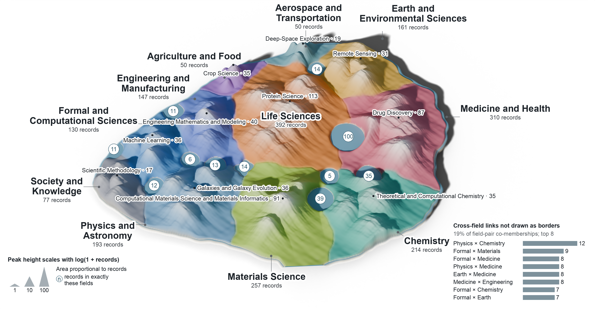

# Fig. 10 Scientific Knowledge Archipelago — 3D v1

A 3D, data-driven redesign of Fig. 10 (v37) for the main text: the same records, fields, theme peaks and shared seas, with field positions and areas computed from the data instead of placed by hand.



## What the figure encodes

| Visual | Data |
|---|---|
| Territory | one top-level field; area proportional to its records (largest relative error 0.03%) |
| Shared border | the two fields co-occur on records; borders come from a maximum-weight planar subgraph (27 edges, the 3V − 6 limit for 11 regions), covering 80.8% of field-pair co-memberships |
| Peak | one of the field's top-4 tertiary categories; height scales with log(1 + records) |
| Sea with a number | records assigned to exactly that combination of fields (the 11 combinations selected in v37), placed on the shared border or three-field junction of its members |
| Inset (bottom right) | the strongest field pairs that are not drawn as shared borders (19.2% of field-pair co-memberships) |

Records: 1,489 records carry a field assignment in `field_memberships.csv`; the v37 caption counts 1,492 unique records.

## Method

1. `scripts/build_data.py` reads the v37 inputs in this repository (`../Fig10_Scientific_Knowledge_Archipelago_v37/inputs/` and `data/field_memberships.csv`) and writes `data.json`: fields, themes, all field-pair co-membership counts, all exact multi-field combinations and the selected seas.
2. `scripts/gen_layout.py` builds the layout on a 2:1 domain (420 × 840 grid):
   - adds field-pair edges by weight while the graph stays planar (maximum-weight planar subgraph);
   - places field centres with a weighted spring layout on that subgraph, then iterates: fields that carry a selected sea are pulled together until they share a border, and centres closer than 0.65 × the sum of their area radii are pushed apart so no field becomes a sliver; the overall spread is kept fixed;
   - assigns territories with a domain-warped power diagram whose weights are tuned until each area matches its records share;
   - raises the theme peaks and cuts the seas as straits along the members' shared border.
   Outputs `layout_archipelago.npz` and `labels_archipelago.json` (3D label anchors, adjacency and area diagnostics).
3. `scripts/render.py` renders the terrain in Blender Cycles (bpy 5.2.4, OptiX GPU): hypsometric tint over the field colours, low warm sun with a cool sky, island-only water, transparent background with a shadow catcher; it also projects every label anchor to image pixels (`anchors_archipelago_cut.json`).
4. `scripts/overlay2.py` assembles the figure: field names around the island perimeter (only the land-locked Life Sciences stays inside), the top theme per field at its summit, sea badges, legend and inset, all as Arial vector text over the render; writes SVG, a 183 mm-wide PDF and a PNG preview.

## Outputs

| File | Content |
|---|---|
| `outputs/fig10_3d_v1.pdf` | submission figure, 183 × 95.3 mm (Nature double column), Arial and Arial Bold embedded, smallest text about 5 pt |
| `outputs/fig10_3d_v1.svg` | same figure with editable text; the render is embedded |
| `outputs/render_archipelago_cut_3456x1800.png` | terrain render with transparent background, about 480 dpi at 183 mm |
| `outputs/fig10_3d_v1_preview.png` | PNG preview on white |

## Reproduce

Python 3.13 with `bpy==5.2.4 numpy scipy networkx shapely pillow cairosvg`, an NVIDIA GPU (OptiX) and the Arial fonts (`render.py` and `overlay2.py` expect `/usr/share/fonts/arial/Arial.ttf` and `Arial Bold.ttf`). Run in one working directory:

```bash
python scripts/build_data.py
python scripts/gen_layout.py
python scripts/render.py archipelago 3456x1800 256 cut
python scripts/overlay2.py archipelago 3456x1800
```

`render.py archipelago 1728x900 96 cut` gives a quick draft in about 10 s. `data/` holds the intermediate files of this version so the figure can be re-assembled without re-running the layout.
