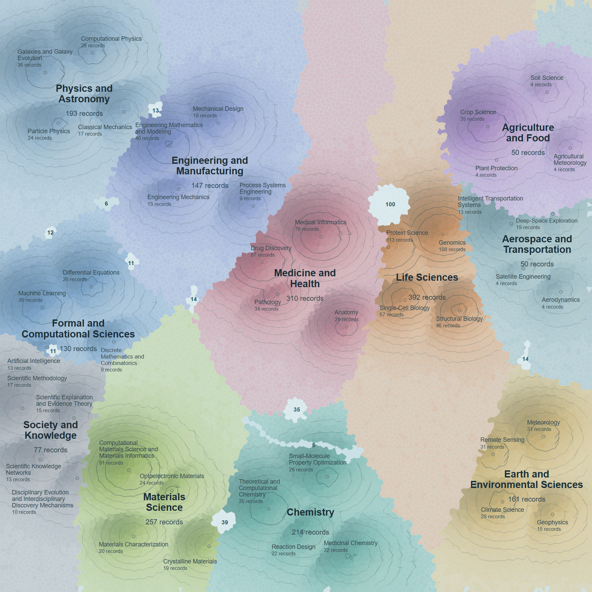

# Fig.10 Scientific Knowledge Archipelago — v37 English

最新版英文科学知识群岛图的独立复现资产。11个一级领域、每领域前四个正式三级类（共44个主题峰）、11处指定的精确跨领域共享海域。山峰标记为小灰色圆环。



## 快速复现

下载整个目录或 Release 的 ZIP，进入本目录运行。脚本不依赖本机旧版目录、桌面文件或原始论文 PDF。

```bash
python -m venv .venv
# Windows PowerShell: .\.venv\Scripts\Activate.ps1
# macOS/Linux: source .venv/bin/activate
python -m pip install -r requirements.txt
python -m playwright install chromium
python reproduce.py
```

输出在 `build/`：

- `fig10_v37.png`：1742 × 1742，浏览器直接渲染。
- `fig10_v37.svg`：可编辑文字、圆环和矢量地形。
- `figure.html`、`figure_fast_editor.html`：完整及快速编辑器，附本地 JavaScript。
- `input_audit.json`、`verification.json`：计数、几何、文字、标记及参考图对比。

只重建 HTML、核验数据，不安装浏览器：`python reproduce.py --build-only`。也可单独运行 `python recount.py`。

安装完成后，绘图不需要网络；渲染程序会阻止 HTTP/HTTPS 请求并核验没有外部请求。

## 精确复现环境

本版参考图使用 Windows 11、Python 3.13.5、Playwright 1.61.0 / Chromium 149.0.7827.55，以及系统 Arial Regular/Bold。版本与字体 SHA-256 见 [reference/environment.json](reference/environment.json)。

```bash
python reproduce.py --strict-pixels
```

此命令额外要求 PNG 与参考文件逐字节一致。字体没有随资产分发；其他系统需要自行安装合法可用的 Arial。跨系统的字体替换和浏览器栅格化可能导致像素或标签位置差异，因此普通模式报告这些差异，严格模式会报错。地形与基础网格、分类计数则始终核验一致；文字重叠和裁切始终视为失败。

## 目录

| 路径 | 用途 |
|---|---|
| `inputs/` | 11领域汇总、44三级类、11海域、固定参数与种子 |
| `data/` | 最小去重记录—分类快照、350类词表、来源与覆盖情况 |
| `src/` | 当前 v37 的完整渲染和编辑器模板 |
| `vendor/` | 固定的 D3 4.13.0、本地地形代码及上游许可 |
| `reference/` | 本次交付的原始 PNG、SVG、文字审计与环境记录 |
| `build.py` | 从明确输入生成 HTML，无旧版本依赖 |
| `recount.py` | 从记录级标签重新计数、重选前四、核验11海域 |
| `reproduce.py` | 离线渲染及自动校验 |
| `verify_package.py` | 核验整个包的文件 SHA-256 |

数据来源和历史快照区别见 [DATA_SOURCES.md](DATA_SOURCES.md)；视觉编码、固定版式和修改入口见 [METHODS.md](METHODS.md)；中英文图注见 [CAPTION.md](CAPTION.md)。

## 常用修改入口

- 英文名称、显示数量：`inputs/fields.csv`、`inputs/themes.csv`。
- 海域组合、数量、锚点、伸缩与旋转：`inputs/selected_seas.csv`。
- 板块中心、种子、网格数、山峰偏移：`inputs/parameters.json`。
- 字体、颜色明暗、等高线和标签避让：`src/map_geometry_template.html` 和 `src/map_fast_template.html`。

正式复现应保持输入不变。修改数量但未更新记录级分类快照时，计数审计会失败，这是为防止图与数据脱节。探索性几何编辑可在生成的 HTML 中进行；外部 SVG 编辑不会自动同步回代码。

本资产保留上游代码许可，见 [THIRD_PARTY_NOTICES.md](THIRD_PARTY_NOTICES.md)。

## English quick start

This folder contains a self-contained, data-bound reproduction of Fig.10 v37. Install `requirements.txt`, run `python -m playwright install chromium`, then `python reproduce.py`. Outputs are written to `build/`. No original PDFs, earlier figure directories, or network requests are needed during rendering. `python recount.py` verifies all displayed counts against the bundled ID–classification snapshot. Pixel-exact reproduction additionally requires the recorded Windows/Arial/browser environment and is checked by `--strict-pixels`.
