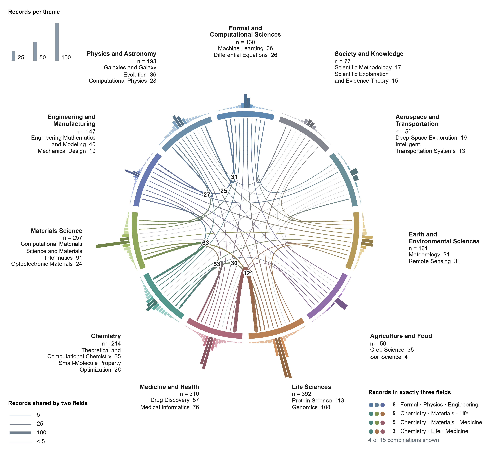

# Fig. 10 Scientific knowledge ring — v1

A ring redesign of Fig. 10 built from the same records as the v37 archipelago. It shows two things at once: what each field works on (its theme composition) and how fields connect (records shared between fields).



## What the figure encodes

| Visual | Data |
|---|---|
| Sector | one top-level field; all sectors have equal width, so arc length carries no data; `n` is the field's record count |
| Outer bars | one bar per third-level theme with records; length = records on one linear scale for all fields; largest theme in the middle of the sector, then alternating outward; the two largest are named |
| Chord | records assigned to both fields (any co-membership), width proportional to records; pairs with fewer than 5 shared records in grey; the 7 strongest pairs are labelled |
| Inset | the four largest combinations of records assigned to exactly three fields (15 combinations exist) |

Field order starts from a science-consensus ring and is refined by a local search that shortens heavily weighted chords. All 53 field pairs with shared records are drawn.

Note: chord counts are co-memberships, so they differ from the v37 sea numbers, which count records in exactly that combination of fields (for example Life–Medicine is 121 here and 100 in v37).

## Outputs

| File | Content |
|---|---|
| `outputs/fig10_ring.pdf` | 183 × 168 mm, Arial embedded |
| `outputs/fig10_ring.svg` | same figure with editable text |
| `outputs/fig10_ring.png` | 600 dpi |

The caption is in `captions/caption_en.txt`.

## Reproduce

Python 3 with `matplotlib` and `numpy`, and Arial installed (the script also loads `/usr/share/fonts/arial/Arial.ttf` and `Arial Bold.ttf` if present). From this folder:

```bash
python scripts/ring_fig10.py outputs/fig10_ring
```

The script reads `../Fig10_Scientific_Knowledge_Archipelago_v37/inputs` and `data`; pass another v37 folder as the second argument if needed. Running it on the repository data reproduces `outputs/fig10_ring.png` byte for byte (checked with matplotlib 3.11.2, numpy 2.5.5).
