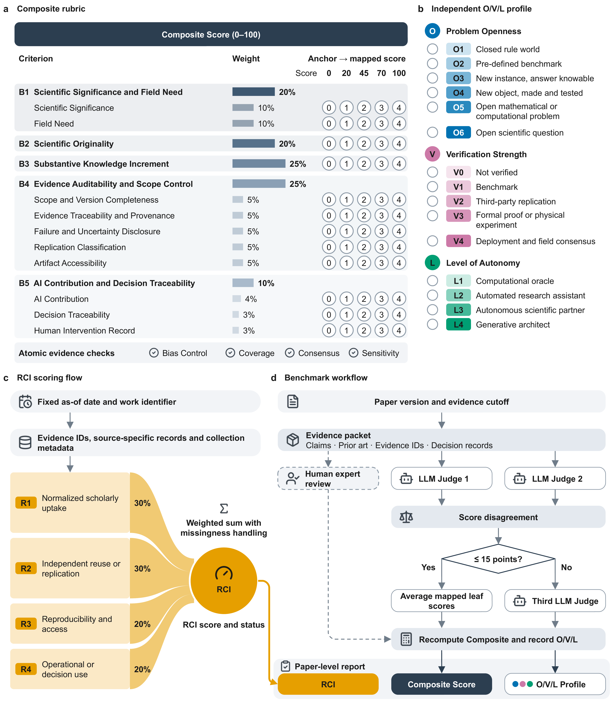

# Fig. 3 Benchmark workflow — editable PowerPoint version

The paper-level benchmark figure (`fig:benchmark`) as one editable PowerPoint slide: every box, arrow and label is a native shape or text box with a name, so the figure can be adjusted by hand in PowerPoint or Keynote.



## Panels

| Panel | Content |
|---|---|
| a | Composite rubric as an answer sheet: B1–B5 and 13 criteria, weight bars, 0–4 anchor bubbles with the mapped score (0, 20, 45, 70, 100) above each column, atomic evidence checks |
| b | Independent O/V/L profile: O1–O6 and V0–V4 as defined in the manuscript, L1–L4 named after Wei et al. (arXiv:2508.14111) |
| c | RCI scoring flow: as-of date and work identifier → evidence records → R1–R4 (30/30/20/20) → weighted sum → RCI |
| d | Benchmark workflow on a three-column grid, with the ≤ 15-point decision; the RCI stream from panel c enters only the RCI output |

Format: 183 mm wide (Nature double column), Arial, body text 7 pt, panel letters 8 pt bold, black or white text only, colour-blind-safe accents (Wong 2011) for O/V/L and RCI. The caption is in `captions/caption_en.txt`.

## Outputs

| File | Content |
|---|---|
| `outputs/fig3_benchmark.pptx` | editable slide |
| `outputs/fig3_benchmark.pdf` | vector PDF exported by LibreOffice 25.8, Arial embedded |
| `outputs/fig3_benchmark_600dpi.png` | 600 dpi preview |

## Reproduce

Node 20 or newer.

```bash
npm install
node build_fig3.js outputs/fig3_benchmark.pptx
soffice --headless --convert-to pdf --outdir outputs outputs/fig3_benchmark.pptx
```

`build_fig3.js` holds all layout constants and texts; the canvas height is the `H` constant near the top.
