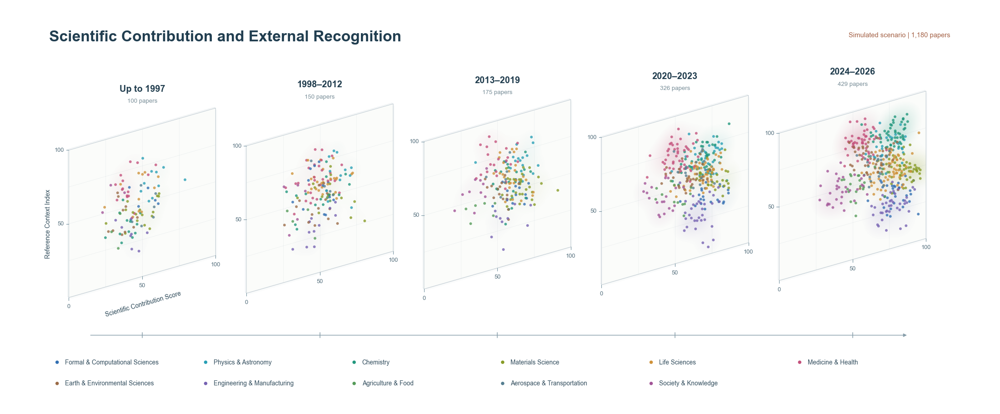

# Contribution–recognition temporal slices — final English figure

Five non-occluding tilted sheets plot scientific contribution score against the Reference Context Index (RCI), colored by domain and grouped by first public disclosure period.



**All 1,180 records are fixed synthetic demonstration data. Running the script does not call an LLM, score papers, retrieve evidence or generate new data.**

## Reproduce

Python 3.11+ is required. From this directory:

```sh
python -m pip install -r requirements.txt
python render_temporal_slices.py --dataset scenario
```

The script writes `outputs/FigY1_v3_fixed_tilt_EN.png`, the editable `.svg`, the smaller `_preview.png`, the actual plotting-data CSV and a provenance/geometry manifest. Matplotlib uses a headless backend; no browser is required.

## Edit

- `design_parameters.json`: score/RCI axis lengths, gaps, point size, opacity, density smoothing, colors, DPI and period labels.
- `data/scenario_papers_1956_2026_EN.csv`: the actual fixed input records. The `score`, `rci`, `domain_index` and `disclosure_year` columns control the plotted coordinates, colors and periods.
- `data/domain_manifest_EN.json`: ordered English domain labels and metadata.
- `captions/caption_bilingual.md`: Chinese and English captions for this simulated example.

The original projection angles remain **16 degrees and -4 degrees**, with identical point coordinates, density backgrounds, colors and sheet layout. The shared English legend uses two rows, and the horizontal-axis title is offset to clear the ticks. Arial is preferred, with Liberation Sans and Matplotlib's bundled DejaVu Sans as portable fallbacks. SVG text remains editable.

The periods are up to 1997, 1998–2012, 2013–2019, 2020–2023 and 2024–2026, with 100, 150, 175, 326 and 429 synthetic records. Each sheet has identical 0–100 axes. These are distinct disclosure cohorts, not repeated measurements of individual papers. The pale wash represents smoothed local point density, not another score. RCI remains separate from scientific contribution. The example applies neither fixed post-disclosure observation windows nor paper-age correction, so its patterns are not empirical or causal findings.

## Provenance

The unchanged `isometric_projection` function from [lanl/pymplot](https://github.com/lanl/pymplot/blob/main/src/module_projection.py) is retained in `vendor/pymplot/`, along with its original source and BSD-3-Clause license. No external repository or local paper library is needed at runtime. The previous Chinese localization script is not required.
