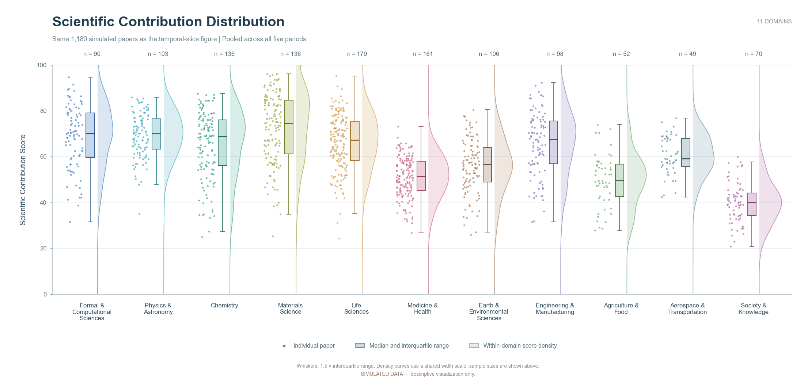

# Scientific Contribution Distribution — Raincloud Plot



The figure reuses the 1,180 simulated paper records and eleven domain colors from the [English temporal-slice figure](../FigY1_Temporal_Slices_v3_FixedTilt_EN/). All five historical periods are pooled, and each score stays on the original 0–100 scale.

Each dot represents one simulated paper; horizontal offsets reduce overlap. The box shows the median and interquartile range, and the whiskers extend to the most extreme observations within 1.5 interquartile ranges of the box. A half-cloud shows within-domain score density on a shared scale, using a common bandwidth of five score units. The labels above the groups give domain sample sizes. This synthetic example demonstrates the layout and does not establish differences between scientific fields.

## Reproduce

Run these commands from this directory using Python 3.13:

```sh
python -m pip install -r requirements.txt
python render_raincloud.py
```

The script reads `plot_config.json` and `data/temporal_slice_simulated_data.csv`, then writes the figure and validation outputs to `outputs/`. The dataset provenance is in `data/source_provenance.json`. Arial is used when installed; otherwise the renderer uses Liberation Sans or DejaVu Sans. It uses local data and does not call any scoring or evidence collection service.

[High-resolution PNG](outputs/Scientific_Contribution_Raincloud_EN.png) · [Editable SVG](outputs/Scientific_Contribution_Raincloud_EN.svg)
