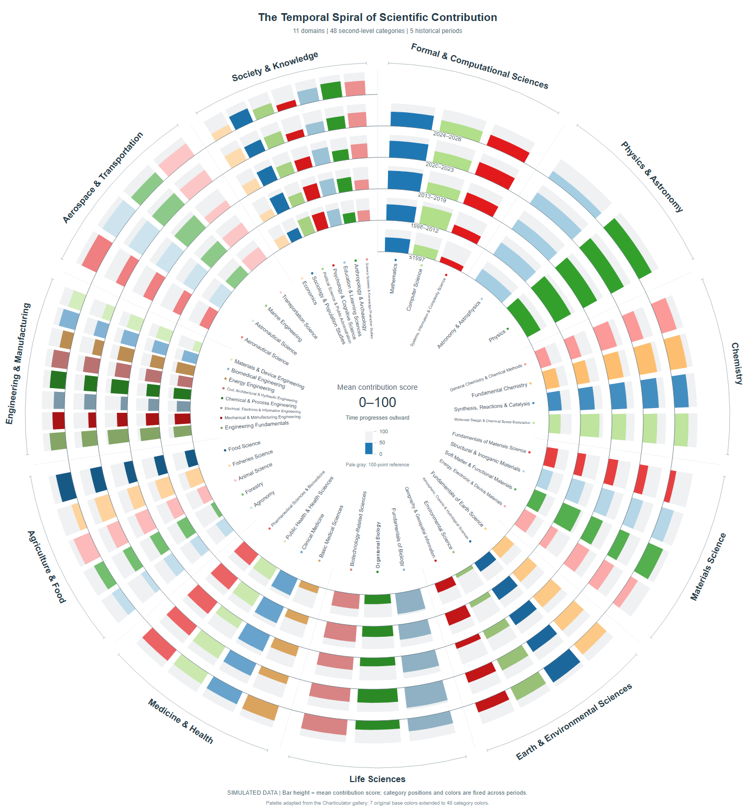

# Scientific contribution spiral — final English figure

Five spiral turns represent five historical periods. Eleven equal-angle domain sectors contain 48 second-level categories; each category has one simulated mean score per period. The category position and color remain fixed across turns.



**All 240 values are synthetic layout examples. No paper scoring is performed.**

## Reproduce

Requirements: Node.js 18+; Python 3.11+ only for PNG rendering. Rendering uses bundled Charticulator geometry; no npm packages or complete Charticulator installation are needed.

From this directory:

```sh
node draw_spiral.mjs
```

This builds `outputs/scientific_contribution_spiral_EN.svg` and `.html`. The local HTML provides zoom, tooltips and cross-period highlighting. GitHub shows its source rather than running it; download and open it locally.

For PNG exports:

```sh
python -m pip install -r requirements-render.txt
python -m playwright install chromium
python render_spiral.py
```

## Edit

- `figure_config.json`: radii, turn spacing, height scale, bar spacing and typography.
- `data/figure_data.json`: actual rendering input. Edit `records[].mean_score` to replace the synthetic values, and `fields[].classes[]` for category labels, colors and fitted label sizes.
- `data/simulated_category_means.csv`: tabular export, not automatically read back into JSON.
- `data/category_colors.csv`: all 48 hex codes and palette derivation.
- `data/taxonomy_translations.csv`: complete bilingual label crosswalk.
- `captions/caption_bilingual.md`: Chinese and English captions, explicitly marked as a simulated example.

Each domain occupies 360/11 degrees. Fewer categories produce wider bars within that domain. Bar height, measured from the local continuous spiral baseline, uses the same 0–100 scale in every turn. Pale gray bars mark 100 points. Category widths and sector areas do not encode publication counts; turn spacing does not encode elapsed years. Missing empirical values must not be replaced by these synthetic values or silently treated as zero.

## Provenance

Native path and coordinate algorithms are from [Microsoft Charticulator](https://github.com/microsoft/charticulator), MIT licensed. Original TypeScript source, the isolated transpiled geometry module, and the full license are retained in `vendor/charticulator/`. The complete editor is not rebuilt. The palette references the [original gallery figure](https://donghaoren.org/charticulator/images/gallery/fitbit_spiral.png): seven base colors are expanded by documented white/black mixing to 48 distinct hex codes; the author did not provide 48 original colors.

The packaged data, colors and bar geometry match the approved English figure. The package does not depend on a Chinese prototype, a local paper library, or another directory on the author's machine. Fonts can vary across systems; Arial/Helvetica are preferred and the browser's sans-serif font is the fallback.
