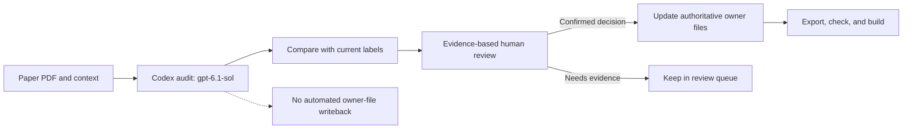

# Agent for Science: Toward Autonomous Scientific Discovery

> A curated, evidence-oriented literature database and classification workflow for research agents that participate in scientific discovery.

<p align="center">
  <a href="https://github.com/zzy451/Autonomous-Scientific-Discovery/stargazers"></a>
  <a href="#collection"></a>
</p>

<p align="center">
  <a href="#collection">Collection</a> |
  <a href="#classification">Classification</a> |
  <a href="#reproduce-the-codex-classification-audit">Codex audit</a> |
  <a href="README.zh-CN.md">中文</a> |
  <a href="MERGE_GUIDE.md">Reviewer handoff</a>
</p>

This repository supports a literature review on how agentic systems participate in scientific research, and how those systems may develop toward autonomous scientific discovery. It provides a curated paper collection, structured records, a scientific-domain taxonomy, classification policies, and reproducible audit tools.

## Contents

- [Collection](#collection)
- [Scope and inclusion criteria](#scope-and-inclusion-criteria)
- [Classification](#classification)
- [Repository map](#repository-map)
- [Reproduce the Codex classification audit](#reproduce-the-codex-classification-audit)
- [Data and evidence](#data-and-evidence)
- [Merge and reviewer handoff](MERGE_GUIDE.md)
- [Citation and use](#citation-and-use)

## Collection

The current review core contains **663 deduplicated papers** (collection snapshot: 2026-10-24). Structured data also contains records outside the confirmed review core, so the number of rows in `papers.jsonl` is not the core-paper count. Papers are discovered from seed reviews and citation networks, then expanded through relevant journals, related systems and teams, and targeted searches for gaps in domain coverage.

The review focuses on systems that take part in research activity: literature search and synthesis, knowledge organization, question or hypothesis generation, experiment design, simulation and tool execution, robotic experimentation, data analysis, interpretation, and evidence checking.

## Scope and inclusion criteria

A paper enters the review core when it meets all four criteria:

1. **Scientific objective:** it addresses an identifiable scientific question, object, or research task.
2. **Multi-step activity:** the system performs related actions over a research process rather than a single input-output response.
3. **Agent behavior:** it demonstrates at least one of planning, tool use, feedback-driven iteration, autonomous decision-making, or multi-agent collaboration.
4. **Research role:** it has a defined role in a research workflow, such as retrieval, hypothesis generation, experiment design, execution, analysis, interpretation, or validation.

Complete autonomy and a closed experimental loop are useful comparison dimensions, but are not required for inclusion. A predictive model, one-shot LLM response, or automated screening pipeline is not included solely because it uses AI.

## Classification

The primary classification follows the **scientific object studied**, not the model, agent architecture, venue, institution, or technique. A paper may map to multiple disciplines when its experiments, benchmarks, case studies, or results provide evidence for multiple scientific objects. Agent type, research-stage role, autonomy, and validation method are kept as complementary descriptors.

The top-level taxonomy covers formal and computational sciences; physics and astronomy; chemistry; materials; Earth and environmental sciences; life sciences; medicine and health; agriculture and food; engineering; aerospace, marine, and transportation; and social, behavioral, economic, and knowledge-system sciences. A separate `01.04` holding category is reserved for general scientific-agent methods without evidence tied to a specific scientific object.

| Code | Scientific-object domain | Papers* |
|---|---|---:|
| 01 | Formal, information, and computational sciences | 88 |
| 02 | Physics, astronomy, and cosmic sciences | 75 |
| 03 | Chemical sciences | 113 |
| 04 | Materials science | 168 |
| 05 | Earth and environmental sciences | 53 |
| 06 | Life sciences | 119 |
| 07 | Medical and health sciences | 117 |
| 08 | Agriculture, food, forestry, livestock, and fisheries | 7 |
| 09 | Engineering and industrial technology sciences | 58 |
| 10 | Aerospace, marine, and transportation sciences | 27 |
| 11 | Social, behavioral, economic, and knowledge-system sciences | 67 |
| 01.04 | General scientific-agent methods without a concrete object | 9 |

*Counts are from the 2026-10-24 collection snapshot. Papers can be assigned to multiple domains, so counts overlap and must not be summed to obtain the collection size. The `01.04` method holding category is separate from the scientific-object taxonomy.

Classification decisions follow the project policy and taxonomy:

- [Review scope and classification policy](Autonomous%20Scientific%20Discovery/review_scope_and_classification_policy.md)
- [Domain classification rules](Autonomous%20Scientific%20Discovery/domain_classification_rules.md)
- [Scientific-domain taxonomy](Autonomous%20Scientific%20Discovery/science_domain_taxonomy.md)
- [Machine-readable classification code index](Autonomous%20Scientific%20Discovery/Data/classification_code_index.json)

## Repository map

| Path | Contents |
|---|---|
| `Autonomous Scientific Discovery/Data/papers.jsonl` | Structured paper records and review status |
| `Autonomous Scientific Discovery/Data/paper_module_taxonomy_assignments.jsonl` | Scientific-object module and taxonomy assignments |
| `Autonomous Scientific Discovery/Data/discipline_code_assignments.jsonl` | Controlled discipline-code assignments |
| `Autonomous Scientific Discovery/Paper_Lists/agent_master_paper_list.md` | Human-readable master paper list |
| `Autonomous Scientific Discovery/Notes/` | Public paper notes organized by scientific domain |
| `Autonomous Scientific Discovery/skills/asd-single-paper-classification-workflow/` | Reusable workflow for evidence-based classification of one paper |
| `Autonomous Scientific Discovery/scripts/` | Data pipeline, consistency checks, and audit utilities |
| `Autonomous Scientific Discovery/prompts/` | Prompts for structured, evidence-based model review |
| `Autonomous Scientific Discovery/Coverage_Check/` | Coverage tracking and compact audit reports |

## Reproduce the Codex classification audit

The audit runner launches one headless Codex CLI task per confirmed core paper. It fixes the model to `gpt-6.1-sol`, supplies extracted full text when an eligible PDF is available, and compares the independent classification with the existing project assignments. When full text is unavailable, it can use a project note as secondary evidence and flags the result as `note_only`. Existing classification labels are comparison baselines, not instructions for the model's decision.

The committed audit snapshot covers 663 papers: 491 were assessed with full-text PDF evidence and 172 with notes only. It produced 1,743 difference rows across 639 papers. These are review leads, not automatic corrections; the run did not write changes back to the project data. Notes-only cases still require source-level checking before they can count as full-paper review.

> [!IMPORTANT]
> The difference count is not an error count. Every proposed change needs human review against the original paper; `note_only` evidence does not establish full-text verification.

Browse the [audit summary](Autonomous%20Scientific%20Discovery/Coverage_Check/codex_classification_audit_gpt-6.1-sol_2026-10-27/summary.json), [classification differences](Autonomous%20Scientific%20Discovery/Coverage_Check/codex_classification_audit_gpt-6.1-sol_2026-10-27/classification_differences.csv), and [manual review triage](Autonomous%20Scientific%20Discovery/Coverage_Check/codex_classification_audit_gpt-6.1-sol_2026-10-27/manual_review_triage.csv). The committed snapshot is a review record; reproducing its exact triage requires the original per-paper results, which are retained in the research workspace.

### Requirements

- Python 3.11 or later
- Codex CLI installed and authenticated
- `pdftotext` for extracting local PDF text
- Network access when obtaining eligible open-access PDFs from arXiv or OpenAlex

### Run

From `Autonomous Scientific Discovery/`:

```bash
python3.11 scripts/audit_classifications_with_codex.py \
  --run-dir Coverage_Check/codex_classification_audit \
  --jobs 4 --reasoning-effort low --timeout 900
```

The model is deliberately pinned by the script to `gpt-6.1-sol`. Runs can be resumed; completed per-paper results are skipped unless `--force` is supplied. Use `--limit N` or repeat `--paper-id ASD-####` to run a small subset first. Add `--context-file PATH` or `--context-dir PATH` to provide supplementary context.

The report files are:

- `classification_differences.csv`: module, secondary-code, tertiary-code, and general-method differences.
- `manual_review_queue.csv`: items that need human review.
- `manual_review_triage.csv`: review items grouped by source limitations, taxonomy gaps, boundary questions, or code cleanup.
- `summary.json`: run counts and evidence-source counts.
- `results/`, `raw/`, and `logs/`: per-paper structured outputs and execution traces. These directories may contain private or large working artifacts and are not included in the public audit snapshot.

Regenerate the review triage after a run:

```bash
python3.11 scripts/triage_classification_differences.py \
  --run-dir Coverage_Check/codex_classification_audit
```



Review every proposed change against `object_evidence` and the cited paper pages before updating owner data files. The audit and triage tools do not write classification decisions back.

## Data and evidence

The public repository is intended to keep structured records, text notes, policies, scripts, and compact reports reviewable. PDFs and per-run model logs/caches are not required to use the metadata or classification workflow. PDF availability and source limitations should be treated as evidence state, not as proof that a paper has been fully reviewed.

The existing repository also tracks reference PDFs with Git LFS. To inspect metadata without downloading the entire PDF library, clone with `GIT_LFS_SKIP_SMUDGE=1 git clone https://github.com/zzy451/Autonomous-Scientific-Discovery.git`. Retrieve individual full texts when needed and respect their source licenses.

For a new paper, use the [single-paper classification workflow](Autonomous%20Scientific%20Discovery/skills/asd-single-paper-classification-workflow/SKILL.md), consult the taxonomy and policy, record evidence with page or section references, and run the repository consistency checks before publishing data changes.

## Citation and use

If you use this collection, please cite the repository and the individual papers that support your analysis. The paper records and notes are provided for research and review; copyright in each paper remains with its authors or publishers. Check each source's license before redistributing full text.

```bibtex
@misc{agent_for_science_asd,
  title        = {Agent for Science: Toward Autonomous Scientific Discovery},
  author       = {Autonomous Scientific Discovery project},
  howpublished = {\url{https://github.com/zzy451/Autonomous-Scientific-Discovery}},
  year         = {2026}
}
```
